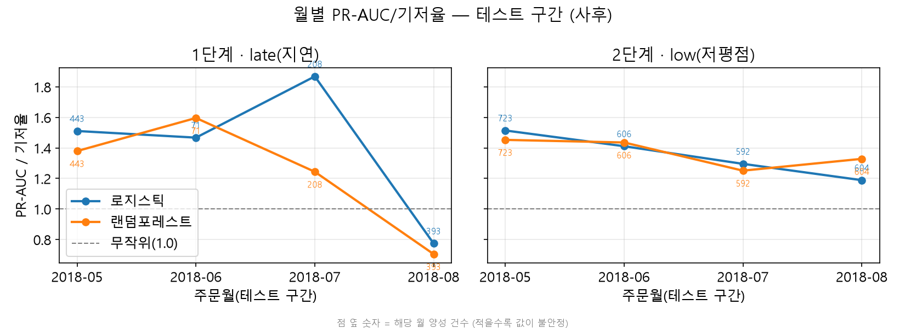

# 주문 시점 정보로 배송 지연과 저평점을 미리 잡아낼 수 있는가

**작성자:** 최연주 &nbsp;&nbsp;|&nbsp;&nbsp; **작성일:** 2026-10-30

     

## 요약 (Executive Summary)

- **데이터:** Brazilian E-Commerce Public Dataset by Olist / https://www.kaggle.com/datasets/olistbr/brazilian-ecommerce
- **규모:** 9개 테이블(주문 99,441건) → 분석 대상 2017-01\~2018-08 도착 완료 주문 **96,204건**
- **문제 유형:** 이진 분류(1단계 지연, 2단계 저평점) + 리뷰 텍스트 수동 분류(3단계)

> 브라질 마켓플레이스 Olist의 주문 데이터로 "고객 불만 조기경보"가 가능한지 세 단계로 확인했다.
> 시간 순서대로 학습(\~2018-04)과 테스트(2018-05\~08)를 나누고, 주문 시점에 알 수 있는 정보만 썼다.
> **1단계(배송 지연)** 는 기저율 수준이었다(PR-AUC가 기저율의 1.04\~1.19배). 원인을 추적해 보니 2018년 8월 초 **예상 배송일이 약 5일 짧아진 시기**에 근거리 주문의 지연이 급증해, 모델이 배운 "멀수록 늦는다"는 관계가 뒤집혀 있었다.
> **2단계(1\~2점 저평점)** 는 약하지만 테스트 4개월 모두 기저율 위의 신호가 있었고(1.35배), 그 대부분(초과분의 약 79%)은 **배송비 합계 하나**로 설명됐다.
> **3단계**에서는 지연이 아닌데도 1\~2점을 준 리뷰 310건을 직접 읽어 분류했다. 가장 큰 불만은 **구성품 누락·오배송·일부만 도착(32.9%)** 이었고, 지연 언급은 4.9%뿐이었다.
> 즉 이 데이터에서 "늦게 와서 불만"보다 **"받은 것이 주문과 달라서 불만"** 이 더 큰 덩어리다.

## 핵심 결과

| 항목 | 내용 |
|---|---|
| 1단계 지연 예측 | 로지스틱 PR-AUC 0.052(기저율 4.4%의 1.19배), RF 1.04배 → **기저율 수준**. 무작위 라벨 테스트와 구분이 어렵고, 학습 CV에서는 거리 하나만 쓴 기준선이 모델보다 높았다 |
| 1단계 원인 진단 | 8월 한 달이 성능을 끌어내림(8월 0.67\~0.77배, 8월 제외 시 1.32\~1.57배, 사후 분석). 같은 시기 예상 배송일이 약 5일 단축 → 지연 라벨 기준 자체가 흔들림 |
| 2단계 저평점 예측 | 로지스틱·RF 모두 1.35배, 상위 10% 경보의 정밀도 15.9%(기저율 10.0%). 무작위 라벨 최대치(1.13배)보다 위 → **약하지만 진짜 신호** |
| 2단계 신호의 정체 | `freight_sum`(주문 배송비 합계) 단독이 기저율 위 초과분의 약 79%를 재현 |
| 3단계 불만 구성 | 비지연·저평점 리뷰 6,400건 추정(층화 표본 310건, 가중): 구성품 누락·오배송·일부 도착 32.9% / 상품 품질·파손 25.2% / 지연 언급 4.9% |
| 3단계 사후 관찰 | 구성품 누락·오배송 불만은 **상품 2개 이상 주문**에 몰려 있음(73.2% vs 단일 상품 17.5%). 사후 탐색이라 가설로만 둔다 |
| 이번에 연습한 기법 | 시간 기준 분할·TimeSeriesSplit 튜닝, 라벨 가용 시점까지 고려한 누수 차단, 기준선·무작위 라벨·양성 대조 진단, 층화 표본 가중 추정과 부트스트랩, 사전 등록·hold-out 격리 |



*테스트 월별 PR-AUC ÷ 기저율. 1단계(지연)는 8월에만 기저율 아래로 떨어지고, 2단계(저평점)는 4개월 모두 기저율 위다.*

## 이 프로젝트에서 신경 쓴 것

- **누수 차단을 "언제 알 수 있었나"까지:** 셀러의 과거 지연율을 처음엔 "구매가 더 이른 주문"으로 계산했다가, 그 주문이 아직 배송 중이면 지연 여부를 알 수 없다는 점을 발견해 **구매 시각 이전에 배송이 끝난 주문만** 쓰도록 고쳤다. 고친 뒤 단변량 AUC가 0.60에서 0.54로 내려갔다(이전 값은 부풀려져 있었다).
- **"모델이 좋다"고 말하기 전에 기준선부터:** 기저율, 단일 변수 기준선, 학습 라벨을 섞은 무작위 라벨 테스트, 라벨 정보를 일부러 넣은 양성 대조로 파이프라인과 신호를 따로 점검했다.
- **미리 정한 것과 결과를 본 뒤 정한 것을 구분:** 3단계는 분류 규칙과 가설을 먼저 커밋하고, 키워드 규칙은 개발용 표본으로만 다듬어 동결한 뒤 평가용 표본(hold-out)에서 한 번만 평가했다. 순서가 어긋난 곳은 숨기지 않고 정정 기록으로 남겼다(`docs/decisions.md` D-33·D-34).
- **문서의 숫자는 코드로:** 문서에 적은 숫자가 노트북·결과표에 실제로 있는지 `tools/check_repo.py`로 점검한다.

## 시사점 (가설)

- 주문 시점 정보만으로 배송 지연을 미리 맞히기는 어렵다. 지연은 주문 이후 물류 단계와 **예상 배송일을 어떻게 잡는가**에 크게 좌우되는 것으로 보인다. 예상일 정책을 바꿀 때는 지연율 지표가 함께 흔들린다는 점을 모니터링에 반영해야 한다.
- 비지연 불만의 가장 큰 덩어리가 "구성품 누락·오배송·일부만 도착"이고 여러 상품 주문에 몰려 있다면, **여러 상품 주문의 출고 검수·분할 배송 안내**가 리뷰 점수를 지키는 지렛대가 될 수 있다. 다만 이는 사후 관찰이므로 별도 검증이 필요하다.

## 폴더 구조와 재현 방법

```
olist/
├─ notebooks/   01~08 1·2단계, 09~10 3단계 대상·표본 추출(기록용), 11 3단계 결과
├─ src/         공통 정의(common.py)와 분석 도우미
├─ tools/       3단계 번역·라벨링·평가·집계 스크립트, 정합성 점검(check_repo.py)
├─ docs/        최종 보고서, 계획서, 결정 기록(decisions), 작업 로그(log), 3단계 규칙·결과
└─ outputs/     결과 표(tables), 그림(figures), 3단계 라벨(labels, 원문 없음)
```

- 상세 보고서: [`docs/final_report.md`](docs/final_report.md)
### 다른 PC에서 실행하기

1. 저장소를 받고 `olist` 폴더로 이동한다: `git clone https://github.com/choi-yeonju/data-analysis-portfolio.git` → `cd data-analysis-portfolio/olist`
2. Python 3.13 가상환경을 만들고 패키지를 설치한다: `python -m venv .venv` → 활성화 → `pip install -r requirements.txt` (Windows·macOS·Linux 모두 설치 확인)
3. 원본 데이터: [Kaggle 데이터셋](https://www.kaggle.com/datasets/olistbr/brazilian-ecommerce)에서 CSV 9개를 받아 `data/raw/` **바로 아래에** 둔다(하위 폴더 없이). `kagglehub.dataset_download("olistbr/brazilian-ecommerce")`로 받아도 된다. `data/interim/`, `data/processed/` 폴더는 저장소에 빈 폴더로 들어 있다.
4. **노트북의 작업 폴더가 `olist`여야 한다.** VS Code에서 `olist` 폴더를 열면 설정(`.vscode/settings.json`)으로 자동 적용된다. Jupyter Lab·Notebook은 노트북이 있는 `notebooks/`를 작업 폴더로 쓰므로, 각 노트북 맨 위에서 `%cd ..`를 한 번 실행한 뒤 진행한다.
5. 노트북 01 → 08을 순서대로 각각 실행한다(전체 약 15\~20분, 07이 가장 오래 걸림). DuckDB를 쓰는 01\~03은 다음 노트북으로 넘어가기 전에 커널을 종료한다.
6. 3단계 결과는 노트북 11로 확인한다. 11은 저장소에 커밋된 결과 표와 라벨만 읽으므로 원본 데이터 없이도 돌아간다.

**재현 범위:** 1·2단계(01\~08)는 원본 CSV만 있으면 처음부터 다시 만들어진다(2026-10-30 새 환경에서 결과 표가 소수 14자리까지 같게 재현됨을 확인). 3단계는 리뷰 원문·번역문, 표본 파일(`data/processed/stage3/`), 번역 API 인증이 필요해 다른 PC에서 다시 돌릴 수 없고, 커밋된 라벨(`outputs/labels/`)과 결과 표, 노트북 11로 확인한다. 09·10은 표본 추출 기록이라 다시 실행하지 않는다. 3단계 도구의 실행 순서는 `docs/README_snippet.md`에 있다.

- 원본 데이터와 리뷰 원문·번역문이 든 파일은 저장소에 올리지 않았다.

## 참고자료

### 데이터 출처

- Kaggle 데이터셋: Brazilian E-Commerce Public Dataset by Olist (`olistbr/brazilian-ecommerce`)
- URL: https://www.kaggle.com/datasets/olistbr/brazilian-ecommerce
- 라이선스: [CC BY-NC-SA 4.0](https://creativecommons.org/licenses/by-nc-sa/4.0/) (Kaggle 데이터셋 페이지 표기). 원본 데이터는 저장소에 포함하지 않았다.
- 리뷰 텍스트 번역: Google Cloud Translation Basic v2

### AI 사용 범위

- 직접 한 것: 분석 질문과 가설 설정, 판단 기준과 최종 결정, 3단계 리뷰 라벨링 310건과 재라벨, 결과 해석
- AI 도움을 받은 것: 코드 초안과 디버깅, 작업물 교차 검토(여러 AI), 문서 문장 정리. 3단계 라벨링 중에는 주로 번역·단어 뜻 설명을 받았다. 다만 dev 1\~50 재라벨 중 4건(#1·#4·#19·#22)은 AI가 라벨을 제안한 뒤 입력했고, 51번 이후와 hold-out은 라벨 제안 없이 달았다(`docs/decisions.md` D-30, `docs/stage3_results.md` 한계 3)

## 회고

- **새로 익힌 기법:** 시간 순서 데이터에서 **라벨을 알 수 있는 시점**까지 따지는 누수 점검, PR-AUC를 기저율로 나눠 월마다 기저율이 다른 구간을 비교하는 방법, 층화 표본의 가중 추정과 층화 부트스트랩, 규칙을 먼저 커밋하고 hold-out으로 한 번만 평가하는 절차.
- **막혔던 지점과 해결 방법:**
  - ① 셀러 과거 지연율의 성능이 좋아 보였는데, 아직 배송 중인 주문의 라벨을 쓰고 있었다 → 배송이 끝난 주문만 쓰도록 바꾸고, 부풀려졌던 수치는 인용하지 않기로 했다.
  - ② 1단계 성능이 테스트에서만 무너졌다 → 월별로 쪼개 8월 한 달이 원인임을 찾고, 거리 구간·예상일·실제 소요일을 나눠 "예상일 단축"이라는 라벨 쪽 변화를 확인했다. 결과를 본 뒤의 분석이라 주 결과는 바꾸지 않고 민감도로만 병기했다.
  - ③ 1·2단계의 "미리 정한 규칙"은 결과와 같은 시점에야 처음 커밋돼 시점을 증명할 수 없었다 → 3단계부터 규칙 문서를 먼저 커밋하고 시작했다.
- **다음 데이터셋에서 보완할 점:** 판정 기준과 집계 방식을 결과 계산 **전에** 커밋하고, 라벨러를 한 명 더 두어 라벨러 간 일치도를 재고 싶다. 3단계에서 본 "여러 상품 주문에 구성품 누락 불만이 몰린다"는 관찰은 미리 등록한 가설로 따로 검증하고 싶다.
